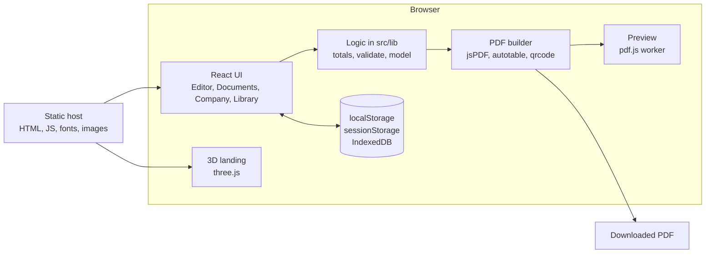
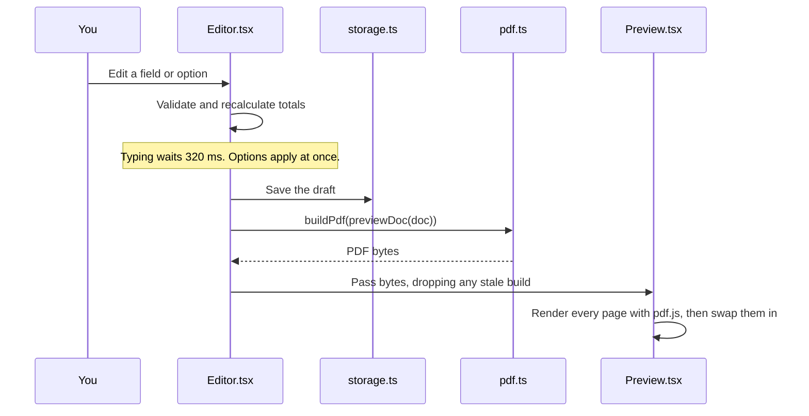

<p align="center">
  
</p>

<p align="center">A GST invoice generator that runs entirely in your browser.<br>No account, no server and no watermark.</p>


## Contents

- [About](#about)
- [Quick start](#quick-start)
- [Features](#features)
- [Architecture](#architecture)
- [Project structure](#project-structure)
- [Pages](#pages)
- [Configuration and branding](#configuration-and-branding)
- [Testing](#testing)
- [Deployment](#deployment)
- [Security and privacy](#security-and-privacy)
- [Known limitations](#known-limitations)
- [Troubleshooting](#troubleshooting)
- [Credits and licence](#credits-and-licence)

## About

Billfold creates invoices, quotations, receipts and other business documents as PDFs, with Indian GST worked out for you. It also tracks what you've billed and what you're owed.

It's a static website. There is no backend, database or login: PDFs are generated in the browser, and your data is stored in that browser. This keeps it free to host and means your invoices are never uploaded. It also means your data doesn't sync between devices, so back it up.

The feature set was informed by studying a public invoice tool. The code, text and branding here are original.

## Quick start

You need [Node.js](https://nodejs.org) 20.9 or newer (developed on Node 24) and npm.

```bash
cd invoice-app
npm install
npm run dev
```

Open <http://localhost:3000>. If that port is taken, the terminal shows the port Next.js chose instead.

- `/` is the landing page.
- `/invoice` opens the portal.

Start at **Company** to enter your GST details, logo and bank details once. Every new document then picks them up.

### Commands

| Command | What it does |
| --- | --- |
| `npm run dev` | Starts the development server with live reload |
| `npm run build` | Builds the static site into `out/` |
| `npm start` | Serves `out/` locally with [`serve`](https://www.npmjs.com/package/serve), downloading it through `npx` if needed. Run `npm run build` first |
| `npm test` | Runs the unit tests |
| `npm run typecheck` | Checks types without building |

The build downloads the Instrument Sans font from Google Fonts, so it needs internet access. The finished site doesn't call any third-party service, unless you press a WhatsApp or email button.

## Features

### Company setup

- GST registration: registered, composition scheme or not registered. This changes the document, which becomes a tax invoice, bill of supply or plain invoice.
- GSTIN checksum validation. A valid GSTIN fills in the state and PAN.
- Logo, signature, company stamp, bank details and UPI ID.
- Defaults for template, colour, payment days, tax rate, terms and notes.
- Running numbers, or financial-year numbers such as `ACM/26-27/0001`.

### Documents

Invoice, proforma invoice, receipt, quotation, estimate, project estimate, purchase order, delivery challan, credit note and debit note. You can switch type while editing, turn a quotation into an invoice, or create a credit note, debit note or receipt from an invoice.

### Tax

- CGST and SGST, or IGST, chosen from the GSTINs and place of supply. You can also choose manually, or use VAT or another tax in any currency.
- Cess, tax-inclusive prices, tax on shipping and other charges, and an HSN/SAC summary.
- Reverse charge, plus export and SEZ supplies under LUT, with the matching wording printed.

### Invoice details

- Decimal quantities, item discounts, line details, and reordering or duplicating lines.
- Discount before or after tax, shipping, other charges and rounding.
- Amount paid and balance due, with amount in words and a UPI QR code that includes the amount.
- Payment terms, e-way bill, vehicle, transport, PO number, project and up to eight custom fields.
- Original, duplicate and triplicate copies, on A4 or US Letter.

### Templates and preview

Five layouts: GST Ledger, Letterhead, Minimal, Bold and Sidebar. Each works with any accent colour. The preview is the real PDF, rendered beside the form. A blank document shows clearly labelled sample items that never reach the downloaded PDF.

### Records

- Billed, received, outstanding and overdue totals.
- Status tracking, with a PAID or CANCELLED mark on the PDF.
- Search and filters by type, status, month and financial year.
- CSV sales register, JSON backup and restore, and payment reminders.
- Clients and products remembered on save, then autocompleted.
- Reusable document templates, and sending through WhatsApp, email, the share sheet or print.

### Calculators

GST, profit margin, business margin, depreciation and employee PF.

### Landing page

A scroll-driven 3D showcase built with three.js, using real templates and app screens. Visitors who prefer reduced motion, or whose device lacks WebGL, get a plain page with the same content.

## Architecture

Next.js builds the app into static files with `output: "export"`. All the work happens on the client.



### How a change reaches the preview



### Key decisions

| Decision | Why |
| --- | --- |
| Static export with no backend | Free hosting, and invoices never leave the device |
| One `Doc` object as the source of truth | The form, totals, PDF, saved copy and backup all use the same shape |
| The preview is the real PDF | What you see is what you send, with no second HTML layout to keep in step |
| Everything read from storage goes through `normalizeDoc` | Stored data and backup files are treated as untrusted and rebuilt with known fields only |
| Money rounded at each step, in the currency's minor units | Avoids floating-point drift and supports zero-decimal currencies |
| `three` and the PDF libraries loaded with dynamic `import()` | Heavy code loads only on the pages that use it |
| Noto Sans embedded in each PDF | The ₹ symbol renders correctly everywhere |

### Where data is stored

| Data | Location | Key |
| --- | --- | --- |
| Saved documents | IndexedDB | Database `billfold`, store `documents` |
| Company and defaults | localStorage | `billfold:business:v1` |
| Clients | localStorage | `billfold:clients:v1` |
| Products | localStorage | `billfold:products:v1` |
| Document templates | localStorage | `billfold:template:<type>:v1` |
| Drafts | sessionStorage, plus localStorage if you opt in | `billfold:draft:<type>:v1` |
| Draft recovery setting | localStorage | `billfold:recovery` |

### Tax calculation

`computeTotals` in `src/lib/totals.ts` runs these steps:

1. Line amount is quantity × rate, less any item discount.
2. A before-tax discount is shared across lines by value, and the last line absorbs any rounding difference.
3. Taxable value is the discounted amount. For tax-inclusive prices, it's worked backwards from the line amount.
4. Tax and cess are calculated per line. CGST and SGST each take half the rate.
5. Tax on shipping and other charges is added if you set a rate for them.
6. An after-tax discount, then rounding, gives the grand total. Balance due is the grand total less the amount paid.

`resolveTaxMode` chooses the structure. Composition or unregistered status in INR, or an LUT supply, means no tax. Otherwise, automatic mode compares the state code in your GSTIN with the place of supply or client GSTIN: different states mean IGST, and the same state means CGST and SGST. Currencies other than INR use a generic tax.

## Project structure

```text
invoice-app/
├── src/
│   ├── app/                  Routes (Next.js App Router)
│   │   ├── page.tsx          Landing page (/)
│   │   ├── invoice/          Invoice editor (/invoice)
│   │   ├── [slug]/           Other document editors (/quotation, /receipt, ...)
│   │   ├── documents/        Saved documents and totals
│   │   ├── clients/          Client list
│   │   ├── products/         Product list
│   │   ├── company/          Company settings
│   │   ├── calculators/      Calculators
│   │   ├── layout.tsx        Root layout
│   │   ├── globals.css       All styles and design tokens
│   │   ├── icon.svg          Browser tab icon
│   │   └── apple-icon.png    iPhone home-screen icon
│   ├── components/
│   │   ├── Editor.tsx        Document form, saving and sending
│   │   ├── Preview.tsx       Renders PDF pages with pdf.js
│   │   ├── DesignPanel.tsx   Template thumbnails, colours, page options
│   │   ├── fields.tsx        Shared form fields and context
│   │   ├── Company.tsx       Company settings form
│   │   ├── Documents.tsx     Totals, filters, list, export, backup
│   │   ├── Library.tsx       Clients and products
│   │   ├── Calculators.tsx   Calculators
│   │   ├── Shell.tsx         App sidebar and mobile menu
│   │   ├── Landing.tsx       Landing page content
│   │   ├── Stage.tsx         3D showcase text and fallback
│   │   └── Logo.tsx          Logo mark and wordmark
│   └── lib/
│       ├── model.ts          Types, defaults, normalizing untrusted data
│       ├── totals.ts         Tax, totals, money, amount in words
│       ├── validate.ts       GSTIN and field validation, state list
│       ├── pdf.ts            The PDF builder and five templates
│       ├── storage.ts        Browser storage, numbering, backup, images
│       ├── share.ts          WhatsApp, email, reminders, CSV, overdue check
│       ├── sample.ts         Sample data for previews and thumbnails
│       ├── scene.ts          three.js landing scene
│       ├── routes.ts         Document routes and page text
│       ├── brand.ts          App name
│       └── core.test.ts      Unit tests
├── public/
│   ├── brand/                Logo files
│   ├── fonts/                Noto Sans for PDFs
│   ├── landing/              Landing page screenshots and textures
│   └── pdf/                  pdf.js worker
├── next.config.mjs           Static export settings
├── vercel.json               Security headers
└── package.json
```

`AGENTS.md` is generated by `next dev`. To stop that, set `agentRules: false` in `next.config.mjs`.

## Pages

| Path | Page |
| --- | --- |
| `/` | Landing page |
| `/invoice` | Invoice editor |
| `/gst-invoice`, `/freelance-invoice`, `/contractor-invoice` | Invoice editor with a preset template |
| `/quotation`, `/estimate`, `/project-estimate` | Quotes |
| `/receipt`, `/proforma-invoice`, `/purchase-order` | Other documents |
| `/credit-note`, `/debit-note`, `/delivery-challan` | Adjustments and goods movement |
| `/documents` | Saved documents and totals |
| `/clients`, `/products` | Saved lists |
| `/company` | Company settings |
| `/calculators` | Calculators |

Editor pages also accept `?id=<id>` to open a saved document, `?from=<id>` to start from a copy, and `?client=<id>` to preselect a client.

## Configuration and branding

There are no environment variables.

| To change | Edit |
| --- | --- |
| App name | `src/lib/brand.ts` |
| Logo | `src/components/Logo.tsx`, `src/app/icon.svg`, `public/brand/` and the shapes in `logo()` in `src/lib/scene.ts` |
| UI colours | Tokens at the top of `src/app/globals.css` |
| Template layouts and default colours | `src/lib/pdf.ts` |
| Accent colour choices | `ACCENTS` in `src/lib/model.ts` |
| Document types | `DOC_TYPES` and `NUMBER_PREFIX` in `src/lib/model.ts`, plus `TOOLS` in `src/lib/routes.ts` |
| Landing page text | `src/components/Landing.tsx` and `src/components/Stage.tsx` |
| 3D showcase length | The `720vh` and `620vh` heights in `src/app/globals.css` |

If you upgrade `pdfjs-dist`, copy its matching worker to `public/pdf/pdf.worker.min.mjs`, because that file isn't updated automatically. Retake the images in `public/landing/` if the design changes.

## Testing

```bash
npm test
npm run typecheck
npm audit --omit=dev
```

The unit tests in `src/lib/core.test.ts` cover tax calculation, rounding, amount in words, GSTIN and field validation, untrusted data handling, numbering, CSV formula protection, WhatsApp links and overdue logic.

> [!NOTE]
> The browser tests used during development aren't in this repository. Only the unit tests run here, so check screens and PDFs by hand after changing them. `playwright-core` is still listed as a dev dependency for adding browser tests.

## Deployment

`npm run build` produces a plain static site in `out/`, which any static host can serve.

**Vercel:** import the project. `vercel.json` applies the security headers automatically.

**Other hosts:** upload `out/`, and do both of the following:

1. Copy the headers from `vercel.json` into your host's configuration. They don't apply anywhere else.
2. Make sure clean URLs work, so `/invoice` serves `invoice.html`.

Use HTTPS. The share sheet requires it, and it protects your visitors.

## Security and privacy

- **No upload:** documents, clients and company details aren't sent to any server. Pressing WhatsApp or email opens that service with a short message containing the client name, document number and amount, and your UPI ID if you've set one. The PDF is never sent automatically.
- **Unencrypted storage:** data is stored unencrypted in the browser, so anyone using the same browser profile can read it. Avoid shared computers, and leave draft recovery off on them.
- **Data loss:** clearing browser data deletes everything. Use **Documents → Data → Back up everything** regularly. Backup files contain your business and client details, so store them carefully.
- **Untrusted data:** stored data and backup files are rebuilt with known fields, types and allowed values. Images must be PNG or JPEG data URLs within a size limit.
- **CSV exports:** cells that a spreadsheet would run as formulas are neutralized.
- **Content Security Policy:** `vercel.json` limits scripts, connections and other resources to the site itself. `script-src` keeps `'unsafe-inline'`, because the Next.js static export and the landing page's WebGL check need it.

## Known limitations

- **Tax rules:** tax treatment and printed wording haven't been reviewed by a tax professional. Have an accountant check them before you issue real invoices.
- **Government systems:** there's no e-invoice IRN, e-way bill generation or GST return filing. The e-way bill field only prints a number you enter.
- **Features that need a server:** cross-device sync, automatic recurring invoices, online payment links and automatic email sending aren't available.
- **Sending:** WhatsApp and email can't attach the PDF automatically. It downloads, and you attach it yourself.
- **PDF scripts:** Noto Sans Latin doesn't cover Hindi and other non-Latin scripts, so that text won't print correctly. Some currency symbols fall back to their ISO codes.
- **Long text:** very long client details can be cut off with "…" in the PDF, most often on the Sidebar template. Check the preview.
- **Country on PDFs:** the country prints as a code, such as `IN`.
- **Reminders:** they only open a message for you to send. Nothing is sent on a schedule.
- **Untested:** UPI QR payments with a real app, real phones, and the smoothness of the 3D scene on real devices. Mobile layouts were tested in emulation only, and the 3D landing scene hasn't been checked in dark mode.
- **Before a public launch:** add a privacy policy, terms and contact details, and check that the name and logo are clear to use. No trademark search has been done.

## Troubleshooting

| Problem | Fix |
| --- | --- |
| The site isn't on port 3000 | Another app is using it. Use the port shown in the terminal |
| The build fails while fetching a font | The build needs internet access for Google Fonts |
| A page shows old content | Hard-refresh the browser. If that fails, stop the server, delete `.next` and start it again |
| Saved data is missing | Data belongs to one browser and one address, so `localhost:3000` and `localhost:3001` have separate data. Restore a backup if you need it elsewhere |
| The preview says "Document fonts could not load" | Check that `public/fonts/` exists and retry |
| WhatsApp or print doesn't open | Allow pop-ups for the site |
| The 3D scene doesn't appear | The device lacks WebGL or has reduced motion turned on. The plain page is expected in those cases |

## Credits and licence

Built with [Next.js](https://nextjs.org), [React](https://react.dev), [three.js](https://threejs.org), [jsPDF](https://github.com/parallax/jsPDF), [jsPDF-AutoTable](https://github.com/simonbengtsson/jsPDF-AutoTable), [pdf.js](https://mozilla.github.io/pdf.js/), [node-qrcode](https://github.com/soldair/node-qrcode), [Lucide](https://lucide.dev) and [Vitest](https://vitest.dev). PDFs use [Noto Sans](https://fonts.google.com/noto/specimen/Noto+Sans), and the interface uses [Instrument Sans](https://fonts.google.com/specimen/Instrument+Sans). Both fonts are under the SIL Open Font License.

The project is marked `private` and has no licence yet, so all rights are reserved by default. Add a `LICENSE` file if you plan to share it.
